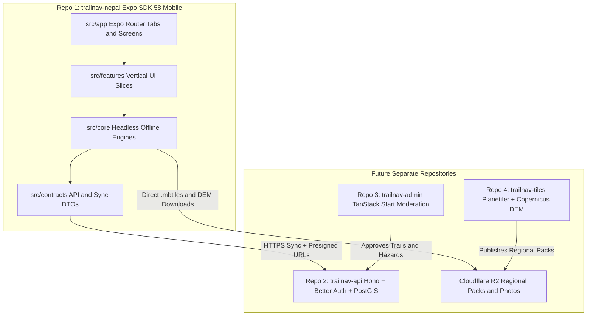
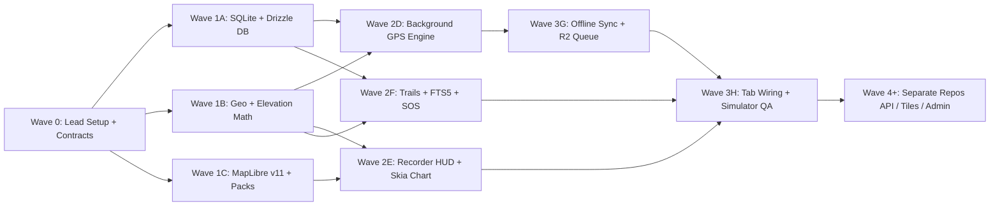

# TrailNav Nepal — Architecture, MCPs, Packages & Multi-Agent Execution Playbook

> **Source of truth:** Derived from [`project.md`](../project.md) and grounded in the current workspace baseline (`Expo SDK 58`, `React Native 0.88.1`, `React 19.3.0`, `@maplibre/maplibre-react-native@11.5.1`).
> **Repository scope:** This repo (`trailnav-nepal`) stays **mobile-only**. Backend API, Admin Moderation Dashboard, and Tile Generation Pipeline live in separate future repositories connected through typed contracts in `src/contracts/`.

---

## 1. Current Workspace Baseline

Before making changes, here is what already exists in `trailnav-nepal`:

- **Runtime & UI foundation:** Expo SDK `~58.0.26`, `expo-router` (`NativeTabs`), `heroui-native`, `uniwind` (Tailwind CSS v4), `react-native-reanimated@4.7.1`, `react-native-gesture-handler`, `react-native-svg`, `@hugeicons/react-native`.
- **Map engine already installed:** `@maplibre/maplibre-react-native@^11.5.1` (New Architecture / Fabric) with plugin configured in `app.json`.
- **Networking & Auth scaffolding:** `axios` (`src/lib/api-client.ts`), `@tanstack/react-query` (`src/lib/query-client.ts`), `better-auth` + `@better-auth/expo` (`src/lib/auth-client.ts`, currently mocked with local `DUMMY_USER` Maya Sherpa until the API exists), `expo-network`, `expo-secure-store`, `zod`.
- **Design system:** Documented in [`DESIGN.md`](../DESIGN.md) ("Calm Focus" — Signal Blue single accent, system font hierarchy, tonal layering in dark mode with zero dark-mode drop shadows).
- **Needs cleanup in Wave 0:** `app.json` and `package.json` still contain starter identifiers (`ReceiptRival`, `com.changteezy.ReceiptRival`, `receiptrival://`, `expo-boiler-plate`).

---

## 2. System Architecture & Repo Separation

Keeping the system separated into **four focused repositories** allows independent deployments, smaller agent context windows, and zero toolchain friction between React Native (Metro/CocoaPods/Gradle), Hono/PostGIS, TanStack Start, and GIS CLI pipelines.



### Repository Boundaries

| Repository                       | Tech Stack                                                                                                 | Responsibility                                                                                                                                          | Connects Via                                                   |
| -------------------------------- | ---------------------------------------------------------------------------------------------------------- | ------------------------------------------------------------------------------------------------------------------------------------------------------- | -------------------------------------------------------------- |
| **`trailnav-nepal`** (this repo) | Expo SDK 58, MapLibre RN v11, `expo-sqlite` + Drizzle, `expo-location`, `expo-sensors`, `expo-file-system` | Offline map rendering, background GPS tracking, elevation smoothing, local SQLite cache, offline SOS & FTS5 search, outbox sync                         | `src/contracts/` REST/JSON schemas + direct R2 HTTPS downloads |
| **`trailnav-api`** (future)      | Hono (Bun or Cloudflare Workers), PostgreSQL + PostGIS (Neon), Drizzle ORM, Better Auth, Cloudflare R2     | Auth, spatial trail/POI queries (`ST_DWithin`, `ST_Simplify`, `ST_Distance`), 2-way track sync, presigned R2 upload URLs, moderation endpoints          | OpenAPI / Zod contract mirrored with mobile `src/contracts/`   |
| **`trailnav-admin`** (future)    | TanStack Start (or Next.js), `maplibre-gl`, `react-map-gl`, Recharts                                       | Review community tracks over satellite + existing trails, inspect elevation spikes, approve/reject/edit geometry, manage hazard reports                 | Calls `trailnav-api` admin routes                              |
| **`trailnav-tiles`** (future)    | Planetiler, Tippecanoe, GDAL, Osmium, `pmtiles` / `mb-util`, Geofabrik Nepal OSM + Copernicus GLO-30 DEM   | Build versioned regional `.mbtiles` (vector + Terrarium DEM hillshade) + `manifest.json` per zone (Poon Hill, Annapurna, Khumbu/EBC, Langtang, Manaslu) | Uploads artifacts + `manifest.json` to Cloudflare R2           |

---

## 3. Internal Mobile Architecture (`src/`)

Inside `trailnav-nepal`, separate **headless engines** (`src/core/`) from **UI vertical slices** (`src/features/`) and **route glue** (`src/app/`). Every directory has a single owner during parallel agent waves.

```text
src/
├── app/                              # Expo Router routes ONLY (thin wrappers)
│   ├── _layout.tsx                   # Imports background task registration at top!
│   ├── (auth)/                       # Existing sign-in / sign-up
│   ├── (app)/
│   │   ├── _layout.tsx               # NativeTabs: Map | Trails | Record | Packs
│   │   ├── map.tsx                   # Renders MapScreen
│   │   ├── trails.tsx                # Renders TrailsScreen (catalog + offline search)
│   │   ├── record.tsx                # Renders RecorderScreen (live HUD + chart)
│   │   └── packs.tsx                 # Renders PacksScreen (regional offline downloads)
│   └── (screens)/
│       ├── settings/                 # Existing settings
│       ├── sos.tsx                   # Offline Emergency SOS screen
│       ├── trail/[id].tsx            # Trail detail + elevation profile + waypoints
│       ├── track/[id].tsx            # Recorded track review + GPX export + submit
│       └── hazard/new.tsx            # Report landslide/bridge/snow hazard
│
├── contracts/                        # Shared DTOs, enums & Zod schemas (Wave 0)
│   ├── index.ts
│   ├── trail.ts                      # Trail, Waypoint, TrailDifficulty, TrailStatus
│   ├── track.ts                      # RecordedTrack, TrackPoint, SyncStatus, GPX types
│   ├── safety.ts                     # SafetyReport, HazardType, AmsAlert, SosReading
│   ├── pack.ts                       # RegionalPackManifest, DownloadProgress
│   └── sync.ts                       # SyncBatchRequest/Response, PresignedUploadDto
│
├── core/                             # Headless engines (NO UI components)
│   ├── db/                           # Agent A — SQLite + Drizzle ORM + FTS5
│   │   ├── client.ts                 # openDatabaseAsync + WAL mode pragma
│   │   ├── schema.ts                 # trails, waypoints, recorded_tracks, track_points,
│   │   │                             # safety_reports, offline_packs, sync_queue
│   │   ├── migrations/               # Drizzle-generated SQL migrations
│   │   ├── repositories/             # Typed CRUD + FTS5 search repositories
│   │   └── seed-poon-hill.ts         # Offline dev fixture (Ghorepani / Poon Hill)
│   │
│   ├── geo/                          # Agent B — Pure TS Spatial & Elevation Math
│   │   ├── distance.ts               # Haversine & Vincenty segment distances
│   │   ├── gps-filter.ts             # Accuracy gate (<= 15-20m), Kalman + moving avg
│   │   ├── rdp.ts                    # Ramer-Douglas-Peucker polyline compression
│   │   ├── elevation.ts              # >3m deadband gain/loss, barometer + DEM fusion
│   │   ├── off-trail.ts              # Point-to-polyline distance (>60m alert)
│   │   ├── bearing.ts                # Bearing & distance to nearest village/teahouse
│   │   ├── gpx.ts                    # GPX <-> GeoJSON LineStringZM import/export
│   │   └── __tests__/                # Fast unit tests (bun test)
│   │
│   ├── maps/                         # Agent C — MapLibre v11 & Offline Tile Files
│   │   ├── style-builder.ts          # Builds dark AMOLED & daylight StyleSpecification
│   │   ├── pack-storage.ts           # expo-file-system File/Directory/Paths manager
│   │   ├── pack-downloader.ts        # Resumable .mbtiles + DEM downloads + checksum
│   │   └── dem-reader.ts             # Local Terrarium DEM tile elevation lookup
│   │
│   ├── tracking/                     # Agent D — Background GPS & Battery Engine
│   │   ├── tasks.ts                  # Module-scope TaskManager.defineTask(...)
│   │   ├── motion-throttle.ts        # Accelerometer stationary check (60s vs 3-5s)
│   │   ├── barometer-tracker.ts      # Barometer relative pressure altitude tracker
│   │   ├── session-store.ts          # Zustand store for live recording metrics
│   │   └── tracking-controller.ts    # Start/pause/resume/stop + permissions flow
│   │
│   ├── safety/                       # Agent F — High-Altitude Safety & Offline Search
│   │   ├── ams-monitor.ts            # >500m/day ascent warning above 3,000m
│   │   ├── sos-locator.ts            # Nearest village/teahouse + Magnetometer bearing
│   │   └── offline-search.ts         # SQLite FTS5 query across downloaded packs
│   │
│   └── sync/                         # Agent G — Offline Queue & R2 Photo Upload
│       ├── outbox.ts                 # Enqueue, retry backoff, conflict resolution
│       ├── network-sync.ts           # expo-network listener -> flush outbox
│       ├── r2-uploader.ts            # Signed URL image compression + direct R2 PUT
│       └── api-adapter.ts            # Typed endpoints matching future trailnav-api
│
├── features/                         # UI Vertical Slices (HeroUI Native + Uniwind)
│   ├── auth/                         # Existing
│   ├── settings/                     # Existing
│   ├── map/                          # Agent C — Offline Topo Map + Layer Controls
│   ├── packs/                        # Agent C — Regional Pack Manager UI
│   ├── recorder/                     # Agent E — Live HUD, Skia Elevation Chart, Submit
│   ├── trails/                       # Agent F — Catalog, Detail, Verified Badges, Search
│   └── safety/                       # Agent F — Emergency SOS Screen + Hazard Form
│
├── components/                       # Shared UI primitives (existing)
├── lib/                              # api-client, auth-client, query-client, fonts
└── utils/                            # env, errors, formatter, logger, platform
```

---

## 4. Verified Packages to Install

All mobile packages below are verified against **Expo SDK 58 (`https://docs.expo.dev/versions/v58.0.0/`)**, **React Native 0.88.1**, and **`@maplibre/maplibre-react-native@11.5.1`**. Always install Expo SDK modules via `bun expo install` so versions stay pinned to `~58.0.x`.

### A. Already Installed in `package.json` (Keep & Use)

- `@maplibre/maplibre-react-native` (`^11.5.1`) — vector tiles, `RasterDEMSource`, `hillshade` layer, `mbtiles:///` local archives, `OfflineManager`
- `expo-router`, `expo-network`, `expo-secure-store`, `expo-haptics`, `expo-image`, `expo-constants`, `expo-device`
- `@tanstack/react-query`, `@tanstack/react-form`, `axios`, `better-auth`, `@better-auth/expo`, `zod`
- `heroui-native`, `uniwind`, `tailwindcss`, `react-native-reanimated`, `react-native-gesture-handler`, `react-native-svg`

### B. Phase 1 & 2 Mobile Core (Install in Wave 0)

```bash
# 1. Expo SDK 58 native modules (location, background tasks, sensors, SQLite, files, battery, alerts)
bun expo install \
  expo-location \
  expo-task-manager \
  expo-sensors \
  expo-sqlite \
  expo-file-system \
  expo-asset \
  expo-battery \
  expo-keep-awake \
  expo-crypto \
  expo-notifications

# 2. Local ORM, state management, geospatial math, and GPX XML parsing
bun add \
  drizzle-orm \
  zustand \
  @turf/distance \
  @turf/nearest-point-on-line \
  @turf/length \
  @turf/bearing \
  @turf/helpers \
  fast-xml-parser

# 3. Dev / build / test tooling
bun add -d \
  drizzle-kit \
  babel-plugin-inline-import \
  @types/geojson
```

> **Why these specific choices?**
>
> - `drizzle-orm` + `drizzle-kit` + `babel-plugin-inline-import`: First-class support for `expo-sqlite` (`drizzle-orm/expo-sqlite` + `useMigrations`), shares exact Drizzle mental model with future PostgreSQL/PostGIS backend.
> - `zustand`: Isolates high-frequency GPS/barometer updates so HUD cards update without forcing full `<Map>` re-renders.
> - `@turf/*` modular packages: Tree-shakeable, zero native dependencies, already aligned with MapLibre RN's internal GeoJSON conventions.
> - `fast-xml-parser`: Pure JS, works cleanly on Hermes without Node DOM polyfills for GPX 1.1 import/export.
> - `bun test`: Built right into Bun (already using `bun.lock`) for fast unit tests in `src/core/geo/` and `src/core/safety/`.

### C. Phase 2–5 Mobile Media, Charts & Sharing (Install Before Wave 2)

```bash
# 60fps GPU elevation profile charts + photo/GPX capture & export
bun expo install \
  @shopify/react-native-skia \
  expo-image-picker \
  expo-image-manipulator \
  expo-document-picker \
  expo-sharing

bun add victory-native
```

> **Optional dev dependency for Expo MCP local simulator automation:**
>
> ```bash
> bun add -d expo-mcp
> ```

### D. Future Separate Repository Packages (Reference Only)

- **`trailnav-api` (Hono + PostGIS + R2):**
  ```bash
  bun add hono @hono/zod-validator zod better-auth drizzle-orm postgres @neondatabase/serverless @aws-sdk/client-s3 @aws-sdk/s3-request-presigner fast-xml-parser
  bun add -d drizzle-kit @types/geojson
  ```
- **`trailnav-admin` (TanStack Start Moderation Dashboard):**
  ```bash
  bun add @tanstack/react-start @tanstack/react-query @tanstack/react-table maplibre-gl react-map-gl recharts zod
  ```
- **`trailnav-tiles` (Offline Nepal Regional Pack Pipeline — macOS / Linux CLI):**
  - `planetiler` (Java) — converts Geofabrik `nepal-latest.osm.pbf` to compact OpenMapTiles vector `.mbtiles`
  - `gdal` (`gdalwarp`, `gdaldem`, `gdal2tiles.py`) — encodes Copernicus GLO-30 30m DEM into Terrarium PNG `.mbtiles` for both hillshade and local altitude lookups
  - `osmium-tool` — clips Nepal OSM extracts by regional GeoJSON polygons (Poon Hill, Annapurna, Khumbu, Langtang, Manaslu)
  - `tippecanoe` — generates contour line vector tiles from DEM contours
  - `wrangler` — uploads regional packs + `manifest.json` directly to Cloudflare R2

---

## 5. MCP Server Stack

### A. Already Connected in Your Cursor Environment

| MCP Namespace                                   | What It Gives TrailNav Agents                                                                                                              | When to Use                                 |
| ----------------------------------------------- | ------------------------------------------------------------------------------------------------------------------------------------------ | ------------------------------------------- |
| **Neon Postgres (`plugin-neon-postgres-neon`)** | Provision Neon branches with `CREATE EXTENSION postgis;`, test spatial SQL (`ST_DWithin`, `ST_Simplify`, `ST_Distance`), inspect schemas   | Wave 4 (`trailnav-api`)                     |
| **Cloudflare (`plugin-cloudflare-cloudflare`)** | Manage R2 buckets (`trailnav-packs`, `trailnav-media`), Workers, logs, and observability                                                   | Waves 3–4 (R2 pack hosting & photo uploads) |
| **Mobbin (`user-Mobbin`)**                      | Search 621k+ real production screens (AllTrails, Gaia GPS, Strava, Komoot, Apple Maps) for outdoor HUD, map sheet, and offline download UX | Before Wave 1 & Wave 2 UI agents            |
| **Figma (`plugin-figma-figma`)**                | Read/write UI screens, design tokens, and component layouts                                                                                | Optional UI design sprints                  |
| **Firecrawl (`plugin-firecrawl-firecrawl`)**    | Scrape current MapLibre style spec, Copernicus DEM docs, OpenTopoMap tagging conventions, and Nepal trail reference data                   | Research & Wave 4 tile pipeline             |
| **Cursor IDE Browser (`cursor-ide-browser`)**   | Automated browser inspection & screenshots                                                                                                 | Wave 5 (`trailnav-admin`)                   |

### B. High-Leverage MCPs to Add Before Running Mobile Agents

Add these in Cursor MCP settings (`~/.cursor/mcp.json` or project `.cursor/mcp.json`):

```json
{
  "mcpServers": {
    "expo-mcp": {
      "url": "https://mcp.expo.dev/mcp"
    },
    "context7": {
      "url": "https://mcp.context7.com/mcp"
    },
    "mobile-mcp": {
      "command": "npx",
      "args": ["-y", "@mobilenext/mobile-mcp@latest"]
    }
  }
}
```

#### Why Each Added MCP Matters

1. **Expo MCP Server (`https://mcp.expo.dev/mcp` + `expo-mcp` dev dep):**
   - Fetches exact Expo SDK 58 documentation and recommends SDK-matched package versions.
   - Local capabilities (run dev server with `EXPO_UNSTABLE_MCP_SERVER=1 bun expo start`): lets agents run `automation_take_screenshot`, `automation_find_view`, and `automation_tap` on the iOS Simulator to visually verify offline maps, dark-mode contrast, and HUD layouts without manual back-and-forth.
   - Connects to EAS Build / Observe for native build diagnostics.

2. **Context7 MCP (`https://mcp.context7.com/mcp`):**
   - Pulls live, version-accurate docs for `@maplibre/maplibre-react-native` v11, `drizzle-orm`, `heroui-native`, `uniwind`, `hono`, `better-auth`, and `@shopify/react-native-skia`. Eliminates hallucinated v10 MapLibre or legacy Expo FileSystem APIs.

3. **Mobile MCP (`@mobilenext/mobile-mcp`):**
   - Drives iOS Simulator (`xcrun simctl`) and Android Emulator (`adb`) via native accessibility trees (fast, low-token) and supports real device control, gestures, and deep links alongside `xcrun simctl location` GPX playback.

4. **Optional (Phase 3+ Backend):**
   - **PostGIS MCP** (`github.com/receptopalak/postgis-mcp`) if running a local Docker PostGIS instance alongside Neon.
   - **GitHub CLI (`gh`)** (already supported via shell) for cross-repo PRs and issues once `trailnav-api` and `trailnav-admin` exist.

---

## 6. Critical Technical Guardrails (Give to Every Agent)

Include this checklist in every agent prompt so no agent writes outdated code:

1. **Expo SDK 58 (`v58.0.0`) FileSystem API:**
   - Use the **modern class API**: `import { File, Directory, Paths } from "expo-file-system";` and `File.downloadFileAsync(url, destination)`.
   - Do **not** import legacy `FileSystem.downloadAsync` from the root entry (legacy lives at `expo-file-system/legacy`).
   - Store `.mbtiles` and DEM files inside `new Directory(Paths.document, "packs")` (persistent, not auto-purged like `Paths.cache`).
   - Never bundle multi-hundred-MB `.mbtiles` via `require(...)` into JS strings; copy small dev fixtures via `expo-asset` or download via `expo-file-system`.

2. **MapLibre React Native v11 (`@maplibre/maplibre-react-native@11.5.1`) Breaking APIs:**
   - Root component is `<Map mapStyle={...}>` — **NOT** `<MapView>`.
   - Layers use `<Layer type="line" | "fill" | "symbol" | "circle" | "hillshade" | "raster" ... />` — **NOT** v10 `<LineLayer>` / `<FillLayer>`.
   - `VectorSource` / `RasterSource` use MapLibre Style Spec props: `tiles`, `minzoom`, `maxzoom`, `scheme` — **NOT** `tileUrlTemplates`, `minZoomLevel`, `maxZoomLevel`.
   - Hillshade uses `<RasterDEMSource id="dem" url={...} encoding="terrarium" tileSize={256}>` with `<Layer type="hillshade" ... />`. On iOS, defining `raster-dem` with `"encoding": "terrarium"` inside the `mapStyle` JSON object is the most reliable cross-platform pattern.
   - Load local downloaded `.mbtiles` via `url: "mbtiles:///absolute/path/to/pack.mbtiles"` (works on both iOS and Android).
   - `OfflineManager` uses auto-generated UUID `pack.id` (not `name`), `mapStyle` (not `styleURL`), `bounds: [west, south, east, north]`, and `addListener`/`removeListener` (not `subscribe`/`unsubscribe`).
   - Use `<Map preferredFramesPerSecond={30} />` when battery-saver mode is active.

3. **Expo Location + Background Tasks (SDK 58):**
   - `TaskManager.defineTask(...)` **must** run at module scope in `src/core/tracking/tasks.ts`, and `import "@/core/tracking/tasks";` **must** be imported at the top of `src/app/_layout.tsx` so headless OS background wakes register the task before navigation mounts.
   - Request foreground location permission first; request background permission only when the user explicitly starts trek recording, with a clear explanation screen (required for App Store / Play Store review).
   - Configure Android `foregroundService` notification in `Location.startLocationUpdatesAsync`.
   - Never write network requests inside the background GPS callback — append raw points straight to SQLite (WAL mode).

4. **Expo SQLite + Drizzle:**
   - Enable `PRAGMA journal_mode = WAL;` and `PRAGMA foreign_keys = ON;` on DB open.
   - Add `.sql` to `metro.config.js` `sourceExts` / `babel-plugin-inline-import` so Drizzle migration `.sql` files bundle cleanly.

5. **Design System ([`DESIGN.md`](../DESIGN.md)):**
   - Follow **The One Voice Rule** (at most one Signal Blue primary CTA per screen), **The One Family Rule** (system font hierarchy), and **The Tonal-Dark Rule** (zero drop shadows in dark mode — tonal elevation only).
   - Default topo map mode should offer **Dark AMOLED** to conserve cold-weather battery.

---

## 7. Step-by-Step Multi-Agent Execution Plan

Run agents in **waves**. Never run two agents in the same wave that edit the same file. Merge & verify each wave's gate before starting the next wave.



---

### Wave 0 — Sequential Foundation (1 Lead Agent)

**Objective:** Rebrand boilerplate to TrailNav Nepal, install Phase 1–2 packages, configure native plugins + Metro, and lock all shared contracts in `src/contracts/`.

- **Owned files:**
  - `package.json`, `app.json`, `metro.config.js`, `babel.config.js` (if needed for Drizzle `.sql`), `drizzle.config.ts`
  - `src/lib/auth-client.ts` (update scheme/storagePrefix to `trailnav`)
  - `src/contracts/*`
- **Key tasks:**
  1. Rename app in `app.json` (`TrailNav Nepal`, slug `trailnav-nepal`, scheme `trailnav`, bundle ID / Android package) and add config plugins for `expo-location` (foreground + background + Android foreground service), `expo-sensors` (`motionPermission`), `expo-file-system`, `expo-sqlite`, `expo-notifications`.
  2. Update `metro.config.js` to preserve Uniwind + add `.mbtiles` to `assetExts` and `.sql` support for Drizzle.
  3. Install Wave 0 packages listed in Section 4B.
  4. Author strict Zod + TypeScript contracts in `src/contracts/` matching `project.md` tables (`Trail`, `Waypoint`, `RecordedTrack`, `TrackPoint`, `SafetyReport`, `RegionalPackManifest`, `SyncEnvelope`).
- **Verification Gate:**
  - `bun expo lint` passes with 0 errors.
  - `bunx tsc --noEmit` passes.
  - `bun expo prebuild --clean` succeeds cleanly (or `bun run ios` / `bun run android` boots without native build errors).

**Copy-Paste Prompt for Wave 0 Agent:**

> Read `project.md` and `docs/ARCHITECTURE_AND_AGENT_PLAYBOOK.md` (Sections 1, 3, 4B, 6). Execute **Wave 0** only:
>
> 1. Rebrand `app.json`, `package.json`, and `src/lib/auth-client.ts` from `ReceiptRival` to `TrailNav Nepal` (`trailnav://`).
> 2. Install the Wave 0 packages from Section 4B using `bun expo install` and `bun add`.
> 3. Configure `app.json` Expo SDK 58 config plugins (`expo-location` with background location + Android foreground service, `expo-sensors`, `expo-file-system`, `expo-sqlite`, `expo-notifications`) and update `metro.config.js` for `.mbtiles` and Drizzle `.sql` imports.
> 4. Create `drizzle.config.ts` and all contract schemas/types in `src/contracts/`.
>    Do not build screens or core engines yet. Run `bunx tsc --noEmit` and `bun run lint` before finishing.

---

### Wave 1 — Local Foundation & Map Engine (3 Parallel Agents)

Spawn **Agents A, B, and C simultaneously** (zero overlapping files).

#### Agent 1A — Local SQLite Database & Repositories

- **Owned files (exclusive):** `src/core/db/**`
- **Read-only:** `src/contracts/**`, `drizzle.config.ts`
- **Deliverables:**
  1. `client.ts`: Open `trailnav.db` via `expo-sqlite`, enforce `PRAGMA journal_mode = WAL;` and `PRAGMA foreign_keys = ON;`.
  2. `schema.ts`: Drizzle SQLite tables mirroring `project.md` (`trails`, `waypoints`, `recorded_tracks`, `track_points`, `safety_reports`, `offline_packs`, `sync_queue`) plus an FTS5 virtual table (`search_index`) for offline teahouse/water/peak/trail search.
  3. Generate Drizzle migrations (`bunx drizzle-kit generate`) and expose a `DatabaseProvider` / `initDatabase()` helper.
  4. Typed repositories (`trailsRepo`, `waypointsRepo`, `tracksRepo`, `safetyRepo`, `packsRepo`, `syncQueueRepo`).
  5. `seed-poon-hill.ts`: Idempotent dev seed for **Ghorepani / Poon Hill** (1 verified trail polyline, 8 realistic waypoints — Nayapul, Tikhedhunga, Ulleri, Ghorepani teahouses, water points, Poon Hill 3,210m viewpoint — and 1 sample hazard report).
- **Verification Gate:** `bunx tsc --noEmit`, Drizzle migrations generate cleanly, repository unit/smoke checks pass.

**Copy-Paste Prompt for Agent 1A:**

> Read `docs/ARCHITECTURE_AND_AGENT_PLAYBOOK.md` (Sections 3, 6, Wave 1A) and `src/contracts/`. You own ONLY `src/core/db/**`. Implement the Expo SDK 58 `expo-sqlite` + Drizzle ORM local database with WAL mode, migrations, FTS5 search index, typed repositories, and an idempotent Ghorepani / Poon Hill dev seed. Do not edit any files outside `src/core/db/`.

#### Agent 1B — Pure Geospatial, GPS Smoothing & Elevation Engine

- **Owned files (exclusive):** `src/core/geo/**`
- **Read-only:** `src/contracts/**`
- **Deliverables:**
  1. `distance.ts`: Haversine + Vincenty distance and cumulative track length.
  2. `gps-filter.ts`: Reject fixes with `accuracy > 20m` (configurable 15–20m), 2D Kalman filter + 5-point moving average fallback for Himalayan valley multipath jitter.
  3. `rdp.ts`: Ramer-Douglas-Peucker simplification preserving altitude (`Z`) and timestamp (`M`) coordinates.
  4. `elevation.ts`: Rolling deadband elevation gain/loss accumulator (only accumulate when upward/downward delta exceeds `> 3m`), barometric pressure-to-relative-altitude delta converter, and DEM + barometer complementary filter.
  5. `off-trail.ts`: Distance from user coordinate to active trail polyline using `@turf/nearest-point-on-line`, triggering alert state when drift `> 60m` (with hysteresis to prevent alert spam).
  6. `bearing.ts`: Compass bearing (0–360°), cardinal direction, and distance to nearest registered village/teahouse.
  7. `gpx.ts`: Lossless GPX 1.1 parser & serializer (`fast-xml-parser`) supporting `<ele>` and `<time>`.
  8. `__tests__/*.test.ts`: Comprehensive `bun test` suite covering synthetic Himalayan jitter, steep gorge altitude noise, RDP compression ratio, off-trail 55m vs 65m threshold, and GPX round-trip.
- **Verification Gate:** `bun test src/core/geo` passes 100% with deterministic fixtures; `bunx tsc --noEmit` passes.

**Copy-Paste Prompt for Agent 1B:**

> Read `docs/ARCHITECTURE_AND_AGENT_PLAYBOOK.md` (Sections 3, 6, Wave 1B) and `src/contracts/`. You own ONLY `src/core/geo/**`. Implement the pure TypeScript geospatial, GPS smoothing, RDP compression, elevation deadband/barometer fusion, off-trail alert (`>60m`), bearing, and GPX utilities along with thorough unit tests runnable via `bun test src/core/geo`. Do not import React Native UI modules.

#### Agent 1C — MapLibre v11 Engine & Offline Regional Packs

- **Owned files (exclusive):** `src/core/maps/**`, `src/features/map/**`, `src/features/packs/**`
- **Read-only:** `src/contracts/**`, `DESIGN.md`
- **Deliverables:**
  1. `src/core/maps/style-builder.ts`: Generates MapLibre v11 `StyleSpecification` JSON for **Dark AMOLED Topo** (default) and **Daylight Topo**, pointing vector sources to `mbtiles:///<path>` and Terrarium DEM sources to `raster-dem` + `hillshade` layer, plus a clean fallback style when no regional pack is downloaded yet.
  2. `src/core/maps/pack-storage.ts` & `pack-downloader.ts`: Uses Expo SDK 58 `expo-file-system` (`File`, `Directory`, `Paths`, `File.downloadFileAsync`) to manage regional packs under `Paths.document/packs/{regionId}/`, track storage size, validate files, and support bundling/copying a sample Poon Hill `.mbtiles` fixture for offline dev verification.
  3. `src/core/maps/dem-reader.ts`: Interface + implementation stub for querying elevation from local Terrarium tiles.
  4. `src/features/map/`: Offline `<Map>` screen (using v11 `<Map>`, `<Camera>`, `<GeoJSONSource>`, `<Layer>`, `<UserLocation>`), layer toggle sheet (Dark/Light, Hillshade, Waypoints, Hazards), active trail polyline rendering, off-trail warning banner, and quick-access SOS button.
  5. `src/features/packs/`: Regional pack manager UI (Poon Hill, Annapurna Circuit, Khumbu/EBC, Langtang Valley, Manaslu) showing size, download status, delete/re-download actions, and offline storage usage following `DESIGN.md`.
- **Verification Gate:** `bunx tsc --noEmit`, `bun run lint`, renders zero-network map screen in simulator without v10 MapLibre APIs.

**Copy-Paste Prompt for Agent 1C:**

> Read `docs/ARCHITECTURE_AND_AGENT_PLAYBOOK.md` (Sections 3, 6, Wave 1C), `DESIGN.md`, and `src/contracts/`. Use Context7 or inspect `node_modules/@maplibre/maplibre-react-native/src/` to strictly follow MapLibre RN v11 APIs (`<Map>`, `<Layer>`, `<RasterDEMSource>`, `mbtiles:///`). You own ONLY `src/core/maps/**`, `src/features/map/**`, and `src/features/packs/**`. Build the offline style builder (Dark AMOLED + Daylight), SDK 58 `expo-file-system` pack storage/downloader, main topo map screen, and regional packs screen.

---

### Wave 2 — Live Tracking, Recorder HUD & Safety/Search (3 Parallel Agents)

Before starting Wave 2, install Section 4C packages (`@shopify/react-native-skia`, `victory-native`, `expo-image-picker`, `expo-image-manipulator`, `expo-document-picker`, `expo-sharing`). Then spawn **Agents D, E, and F in parallel**.

#### Agent 2D — Background GPS & Battery-Aware Tracking Engine

- **Owned files (exclusive):** `src/core/tracking/**`
- **Read-only:** `src/contracts/**`, `src/core/db/**`, `src/core/geo/**`
- **Deliverables:**
  1. `tasks.ts`: Module-scope `TaskManager.defineTask(TRAILNAV_LOCATION_TASK, ...)` that runs `gps-filter` -> appends points directly to SQLite `track_points` -> updates live Zustand store metrics + triggers local notification if off-trail (`> 60m`).
  2. `motion-throttle.ts`: Uses `expo-sensors` `Accelerometer` to detect stationary periods (> 2 min low variance) and dynamically adjust GPS polling interval (60s stationary vs. 3–5s moving).
  3. `barometer-tracker.ts`: Subscribes to `Barometer` when available to feed high-precision relative elevation deltas into `src/core/geo/elevation.ts`.
  4. `session-store.ts`: Zustand store holding active track ID, recording state (`idle | recording | paused`), live distance, filtered altitude, elevation gain/loss, moving time, battery level (`expo-battery`), and off-trail status.
  5. `tracking-controller.ts`: Progressive permission flow (foreground first -> clear rationale -> background), `Location.startLocationUpdatesAsync` with Android foreground service notification, pause/resume, and stop (runs RDP compression + saves completed `recorded_tracks` row + queues sync item).
- **Verification Gate:** `bunx tsc --noEmit`, `bun run lint`, state transitions tested with mock GPS coordinates.

**Copy-Paste Prompt for Agent 2D:**

> Read `docs/ARCHITECTURE_AND_AGENT_PLAYBOOK.md` (Sections 3, 6, Wave 2D). You own ONLY `src/core/tracking/**`. Build the background location tracking engine using Expo SDK 58 `expo-location`, `expo-task-manager`, `expo-sensors` (Accelerometer + Barometer), `expo-battery`, and Zustand, writing points straight to `src/core/db` and smoothing via `src/core/geo`. Note: leave importing `@/core/tracking/tasks` inside `src/app/_layout.tsx` to Wave 3H (or document the exact 1-line import needed).

#### Agent 2E — Live Recorder HUD, Skia Elevation Chart & Submission Flow

- **Owned files (exclusive):** `src/features/recorder/**`
- **Read-only:** `src/contracts/**`, `src/core/tracking/**`, `src/core/db/**`, `src/core/geo/**`, `DESIGN.md`
- **Deliverables:**
  1. Live Trek HUD screen: high-legibility outdoor metrics (distance km, altitude m, gain/loss m, moving time, pace), battery-saver toggle, start/pause/resume/stop controls (using `DESIGN.md` pill buttons + One Voice Signal Blue rule).
  2. `ElevationProfileChart.tsx`: 60fps GPU-rendered chart built with `@shopify/react-native-skia` (or `victory-native`) driven by Reanimated shared values, supporting touch scrub to inspect altitude & grade at any km mark.
  3. Track Save & Community Route Submission flow: title, difficulty picker, waypoint tagging + photo capture (`expo-image-picker` + `expo-image-manipulator` resize/compress), GPX export via `expo-sharing`, and enqueue for community review.
- **Verification Gate:** `bunx tsc --noEmit`, `bun run lint`, renders smoothly with 2,000+ synthetic elevation points.

**Copy-Paste Prompt for Agent 2E:**

> Read `docs/ARCHITECTURE_AND_AGENT_PLAYBOOK.md` (Sections 3, 6, Wave 2E) and `DESIGN.md`. You may use the Mobbin MCP to inspect clean outdoor GPS recorder HUD references. You own ONLY `src/features/recorder/**`. Build the live trek HUD, 60fps Skia elevation profile chart, and post-trek save/GPX-export/community-submission flow wired to `src/core/tracking` and `src/core/db`.

#### Agent 2F — Offline Trails Catalog, FTS5 Search & High-Altitude Safety / SOS

- **Owned files (exclusive):** `src/core/safety/**`, `src/features/trails/**`, `src/features/safety/**`
- **Read-only:** `src/contracts/**`, `src/core/db/**`, `src/core/geo/**`, `DESIGN.md`
- **Deliverables:**
  1. `src/core/safety/ams-monitor.ts`: Evaluates sleeping/daily elevation gain above `3,000m`; raises AMS caution if net ascent exceeds `> 500m/day`.
  2. `src/core/safety/sos-locator.ts`: Queries local SQLite waypoints for nearest `teahouse` / village, computes exact distance + bearing via `src/core/geo/bearing.ts`, and fuses `Magnetometer` heading for a live offline directional pointer.
  3. `src/core/safety/offline-search.ts`: Instant offline FTS5 search across downloaded trails, teahouses, water sources, passes, and peaks.
  4. `src/features/trails/`: Offline trails list & detail screen, offline search bar with category filter chips (Teahouse, Water, Pass, Viewpoint, Hazard), and distinct **Verified Official Trail** vs. **Unverified Community Track** badges (with safety disclaimer modal/banner).
  5. `src/features/safety/`: High-contrast **Emergency SOS Offline Screen** (extra-large GPS Lat/Lon in DD & DMS, altitude, copy/SMS coordinate button, bearing & distance to nearest teahouse/village) + **Report Hazard** screen (`landslide`, `blocked_pass`, `wildlife`, `broken_bridge`, `snow_ice`) saving offline to SQLite + sync queue.
- **Verification Gate:** `bun test src/core/safety`, `bunx tsc --noEmit`, `bun run lint`.

**Copy-Paste Prompt for Agent 2F:**

> Read `docs/ARCHITECTURE_AND_AGENT_PLAYBOOK.md` (Sections 3, 6, Wave 2F) and `DESIGN.md`. You own ONLY `src/core/safety/**`, `src/features/trails/**`, and `src/features/safety/**`. Implement the AMS ascent-rate monitor (`>500m/day` above `3,000m`), offline nearest-village/teahouse bearing locator, SQLite FTS5 search, trails catalog/detail screens with Verified vs. Community badges, Emergency SOS offline screen, and Hazard Reporting flow. Add unit tests for `ams-monitor` and `sos-locator`.

---

### Wave 3 — Offline Sync Engine, Navigation Wiring & Simulator QA (2 Parallel Agents)

#### Agent 3G — Offline Outbox Sync & Cloudflare R2 Photo Uploader

- **Owned files (exclusive):** `src/core/sync/**`, `src/api/endpoints.ts`
- **Read-only:** `src/contracts/**`, `src/core/db/**`, `src/lib/api-client.ts`
- **Deliverables:**
  1. `outbox.ts`: Persistent SQLite outbox processor with exponential backoff, deduplication by client UUID, and `local_only -> pending -> synced` state transitions.
  2. `network-sync.ts`: Subscribes to `expo-network` reachability changes; automatically flushes queued tracks, hazard reports, and photos when back on Wi-Fi/cellular.
  3. `r2-uploader.ts`: Compresses waypoint/hazard photos via `expo-image-manipulator`, requests presigned PUT URL from `api-adapter.ts`, and streams binary upload directly to Cloudflare R2.
  4. `api-adapter.ts`: Typed client against future `trailnav-api` endpoints with a toggleable `EXPO_PUBLIC_OFFLINE_MOCK=true` mode so the full app works smoothly before `trailnav-api` is deployed.

#### Agent 3H — App Routing, Lifecycle Wiring & End-to-End Simulator Verification

- **Owned files (exclusive):** `src/app/**`, `src/providers/app-providers.tsx`
- **Read-only:** All `src/features/**` and `src/core/**`
- **Deliverables:**
  1. Import `import "@/core/tracking/tasks";` at the very top of `src/app/_layout.tsx` and initialize SQLite migrations + Poon Hill dev seed + network sync listener in `src/providers/app-providers.tsx`.
  2. Update `src/app/(app)/_layout.tsx` `NativeTabs` to four core tabs: **Map**, **Trails**, **Record**, **Packs** (keeping Settings and SOS accessible via header/stack routes under `src/app/(screens)/`).
  3. Wire all route files (`map.tsx`, `trails.tsx`, `record.tsx`, `packs.tsx`, `sos.tsx`, `trail/[id].tsx`, `track/[id].tsx`, `hazard/new.tsx`).
  4. Run end-to-end visual & functional verification using **Expo MCP** (`automation_take_screenshot`, `automation_tap`) or **Mobile MCP** on iOS Simulator / Android Emulator.

---

### Waves 4 & 5 — Future Separate Repositories (When Mobile Core Is Stable)

1. **Wave 4A — Create `trailnav-api` repo:**
   - Scaffold Hono + Drizzle ORM (`pg-core`) + Better Auth + Neon Postgres (enable `CREATE EXTENSION postgis;` via Neon MCP).
   - Copy `src/contracts/` into `trailnav-api/src/contracts/` (or publish as a private package later).
   - Implement spatial tables (`GEOMETRY(LineStringZM, 4326)`, `GEOMETRY(PointZ, 4326)`, GIST indexes), `/sync/tracks`, `/trails`, `/safety-reports`, `/packs/manifest`, and `/media/presign` (Cloudflare R2 via Cloudflare MCP).

2. **Wave 4B — Create `trailnav-tiles` repo:**
   - Script automated builds for Poon Hill (pilot), Annapurna Circuit, Khumbu/EBC, Langtang, and Manaslu using `osmium`, `planetiler`, and `gdal` (Copernicus 30m DEM -> Terrarium `.mbtiles`).
   - Publish packs + SHA-256 `manifest.json` to Cloudflare R2 bucket.

3. **Wave 5 — Create `trailnav-admin` repo:**
   - Scaffold TanStack Start moderation dashboard with MapLibre GL JS satellite overlay, elevation spike inspector, and one-click Approve / Reject / Edit Geometry actions against `trailnav-api`.
   - Verify flows using `cursor-ide-browser` MCP.

---

## 8. Field & Simulator QA Checklist

Run this verification suite before shipping any milestone:

- [ ] **Zero-Network Cold Boot:** Enable Airplane Mode on device/simulator -> launch app -> verify Poon Hill vector tiles, hillshade overlay, waypoints, and offline FTS5 search all load with zero network errors.
- [ ] **Simulated Himalayan Track Playback:** Replay a GPX track with injected valley jitter using `xcrun simctl location <udid> start poon-hill.gpx` (iOS) or `adb emu geo fix` (Android) -> verify Kalman smoothing, `> 3m` deadband elevation gain/loss, and `> 60m` off-trail alert trigger.
- [ ] **Screen-Off Background Recording:** Record with screen locked for 6+ continuous hours on physical device -> verify Android foreground notification stays alive, stationary accelerometer throttling drops polling to 60s, and battery drain stays within target.
- [ ] **High-Altitude Safety Verification:** Feed synthetic altitude progression `3,100m -> 3,700m` within 24h -> confirm AMS warning fires; open SOS screen in Airplane Mode -> confirm Lat/Lon, altitude, and bearing arrow to nearest teahouse render clearly in dark/sunlight modes.
- [ ] **Offline-to-Online Sync:** Record a track + hazard report + photo offline -> restore connectivity -> verify `sync_queue` flushes idempotently without duplicates.
